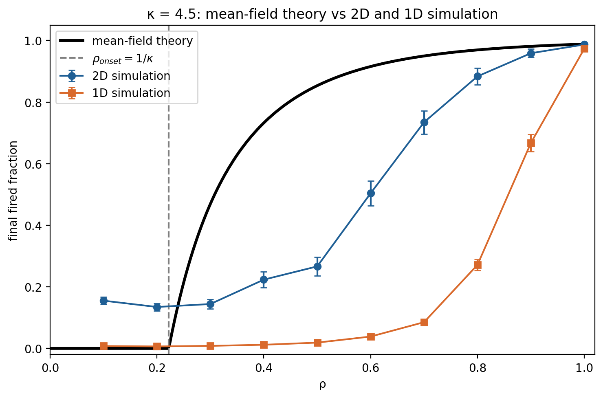

# Mousetrap chain reactions: mean-field theory vs lattice simulation
An introductory complex-systems modelling project. A chain reaction of mousetraps and ping-pong balls is simulated on a 1D and a 2D lattice and compared with a mean-field branching-process theory. The question: above which trap density does the reaction become macroscopic, and what fraction of traps does it fire?

The same model is then extended twice. Adding re-arming turns it into a spatial population model (Notebook 5), and removing depletion while adding leakage and delayed offspring turns it into a nuclear chain reaction (Notebook 6). Both extensions are tested against mean-field theory in the same way.

## The problem

This project answers an International Physicists' Tournament (IPT) problem from 2021:

> An array of mousetraps and ping-pong balls results in a chain reaction. Construct a model for the  macroscopic dynamics of such a system, identifying all relevant parameters, and determine the spatiotemporal behavior of the mousetrap excitation probability, and the threshold mousetrap density for the chain reaction to occur.

How the project maps onto the three requirements:

| Requirement | Where it is addressed |
|---|---|
| A model of the macroscopic dynamics, with all relevant parameters | The lattice model and the branching-process theory below. The parameters are the trap density ρ, the number of attempts per fired trap `m`, the short/long-range mix `p_long`, the success probabilities `p_succ_short` and `p_succ_long(k)`, and the distance distribution `f_k`. They combine into one number, κ. |
| The spatiotemporal behaviour of the excitation probability | The simulations record the state of every cell at every generation (Notebooks 0 and 1), and the mean-field iteration gives the density of newly activated traps per generation (Notebooks 3 and 4, sections 3.3 and 4.3). No closed-form space-time solution is derived. |
| The threshold density for the chain reaction | ρ_onset = 1/κ, tested against simulation at the default parameters and in a supercritical setting (see Results). |

*Mean-field prediction (black) against simulation in 2D (blue, L = 100) and 1D (orange, L = 2000), for κ = 4.5. Points are means with standard errors.*

## Model

Traps sit on a lattice, each cell occupied with probability ρ. One random trap is fired. Every fired trap makes `m` independent attempts per generation, and each attempt is either:

- **short-range** (probability `1 - p_long`): a nearest-neighbour hop, success probability `p_succ_short`;
- **long-range** (probability `p_long`): a distance `k ≥ 2` is drawn from `f_k`, one site at that distance is chosen at random (2 sites in 1D, a Chebyshev ring in 2D), and it fires with probability `p_succ_long(k)`.

A fired trap becomes spent after one generation. Cells are inert, armed, firing or spent.

## Theory

- **Branching number** κ: the mean number of successful attempts per fired trap. The simulator picks one branch per attempt, so
  κ = m [ (1 − p_long) q_s + p_long q_ℓ ], with q_s = `p_succ_short` and q_ℓ = E[`p_succ_long(k)`].
- **Onset density:** a cascade can only grow if ρκ > 1, so ρ_onset = 1/κ.
- **Final size:** the final fired fraction F solves F = 1 − exp(−ρκF), which has a non-trivial root only for ρκ > 1. The equation comes from a Poisson argument: each site receives a Poisson number of attempts with mean κρF.

## Tests

Three comparisons between theory and simulation, in both geometries:

1. **κ itself:** traps fired in generation 1 against ρκ (z-scores and a fitted slope).
2. **Final fired fraction** against F(ρ) (standard errors, RMSE, several lattice sizes).
3. **Onset density:** where P(fired fraction > threshold) crosses 50%, for several thresholds and sizes.

## Results

**Default parameters (`m = 1`, `p_long = 0.5`): κ = 0.497, onset at ρ = 2.01.** Every density is subcritical, and theory and simulation agree.

- κ matches: 2D fitted 0.492, 1D fitted 0.493 (|z| ≤ 1.59 and ≤ 0.45).
- Both predict essentially no macroscopic cascade. The simulated fired fraction falls as the lattice grows (2D RMSE 0.0017 at L = 50 and 0.0004 at L = 100).

**Supercritical test (`m = 5`, `p_long = 1`, `p_succ_long = 0.9`): κ = 4.5, onset at ρ = 0.222.** This is the part that tests the theory.

| | 2D (L = 50, 100) | 1D (L = 1000, 2000) |
|---|---|---|
| Fitted κ (theory 4.5) | 4.43 | 3.87 |
| Final fraction vs theory | within 0.01 for ρ ≥ 0.7; theory too high near the onset | 0.02 vs 0.85 at ρ = 0.5; falls as L grows |
| RMSE | 0.13 | 0.56 – 0.59 |
| Onset offset from 1/κ | +0.10, stable | +0.35 to +0.51, grows with L |

- **κ counts attempts, not new traps.** The simulator merges several hits on the same trap within a generation. In 1D a hop at distance `k` has only two target sites, so the five attempts often coincide: the expected number of distinct targets is 3.85, matching the 1D fit.
- **The final-size theory works in 2D and fails in 1D.** Mean-field assumes every attempt lands on a uniformly random site.
- **Hypothesis (not tested directly):** attempts are local (mean distance ≈ 4.3 sites), so the cascade travels as a front and the sites within reach behind it are already spent. In 1D one of a trap's two nearest neighbours is always the trap that fired it, so the effect is much stronger.

## Limits

- One supercritical parameter set was tested.
- 2D uses 50 runs per density, 1D uses 100; near the onset the error bars are large.
- The 1D fired fraction has not converged with lattice size at ρ ≤ 0.9, so whether a macroscopic transition exists there is open.
- The effective κ (3.85 in 1D) has been measured but not put into the prediction.

## Next steps

1. Test the locality hypothesis: draw `k` from a distribution uniform over the whole lattice and check whether the mean-field curve returns.
2. Repeat with other values of `m` and other kernels.
3. Use the effective κ in the final-size equation and plot how much of the gap it explains.

## Extension 1: population dynamics (Notebook 5)

A fired trap reproduces by firing others, uses up a finite resource (armed traps), and dies (becomes spent). One parameter is added: `p_regen`, the probability per generation that a spent trap is re-armed. With it, the 2D lattice becomes a spatial stochastic SIRS model. Here ρκ plays the role of R₀, and F = 1 − exp(−ρκF) is the Kermack–McKendrick final-size equation.

Each question is answered by the lattice simulation and by a mean-field map (s, i, r = armed, firing and spent fractions). The supercritical set from 3.9 is used (κ = 4.5).

| Question | Mean-field prediction | Lattice result |
|---|---|---|
| **Invasion** (5.3) | possible iff ρκ > 1; probability q from a Galton–Watson process | threshold confirmed at ρ = 1/κ; q follows the Binomial(m) curve for ρ ≥ 0.4 and falls below it just above threshold (0.10 vs 0.26 at ρ = 0.25) |
| **Long-term state** (5.4) | stable fixed point, damped oscillations (\|λ\| = 0.91, period 12.5) | sustained oscillations at period ≈ 13; amplitude ∝ L^b with b = −1.00 ± 0.13, so they are noise-driven quasi-cycles, not a limit cycle |
| **Regulation** (5.5) | s* ≈ 1/κ, independent of ρ | s* stays at 0.256–0.270 while ρ changes 2.5-fold; i* matches mean-field; simulated s* lies 5–11% above mean-field |
| **Stochastic extinction** (5.6) | none: every ρκ > 1 population persists | persistence depends on L; all runs collapse onto P = 1 − exp(−N_min/N₀) with N₀ = 2.34 ± 0.27, where N_min = L² i_min is the mean-field trough count |

- **Mean-field gets right:** thresholds, equilibrium values, the oscillation frequency, and the overall sequence of invasion, overshoot and return to equilibrium.
- **Mean-field misses demographic noise:** failed invasions above threshold, oscillations that never die out, and extinction in the first trough. All three vanish as L → ∞.
- **Mean-field misses locality:** attempts land on spent neighbours, so the effective κ is lower. This lowers invasion near threshold, raises s*, and deepens the trough. It is the same mechanism as the onset offset in Notebook 3 and the 1D failure in Notebook 4.

**Limits:**
- One parameter point was studied in depth.
- Sample sizes are small: 3 runs per L in 5.4, 30 per point in 5.6.
- L spans only a factor of about 3.
- Only extinction in the first trough was measured.

## Extension 2: nuclear fission (Notebook 6)

Neutrons are the offspring. Each fission emits ν ~ P(ν) neutrons, using ²³⁵U data (ν̄ = 2.41, Var ν = 1.22). Each neutron flies a geometric distance, then either causes a fission (probability p_f), is absorbed, or leaks out of the lattice. The multiplication factor is k∞ = ρ ν̄ p_f.

Three changes from the mousetrap model:
1. **No depletion.** A cell can fission any number of times, so the process is linear.
2. **Open boundary.** Neutrons that leave the lattice are lost (leakage).
3. **Delayed neutrons.** A fraction β is released after a geometric delay with rate λ.

| Question | Theory | Lattice result |
|---|---|---|
| **Linearity check** (6.2) | ⟨N_t⟩ = k^t N₀ | matches at k = 0.9, 1.0, 1.1 within 0.7σ |
| **Initiation** (6.3) | 1 − q = G(1 − q) with the real P(ν) | threshold at k∞ = 1; for k∞ ≥ 1.2 within 1.5σ of the P(ν) curve and 3.6–6.8σ above Poisson; no locality deficit |
| **Critical size** (6.4) | k_eff = k∞/(1 + M²B²) (diffusion); exact value = dominant eigenvalue of the fission matrix (FFT power iteration) | simulation matches the fission matrix within ≈ 1σ for L ≤ 20; L_c ≈ 9 at k∞ = 1.3; plain diffusion overestimates L_c by ≈ 2 cells, diffusion + extrapolation distance is within 0.5 cells for k∞ ≤ 1.8 |
| **Kinetics** (6.5) | 2×2 point-kinetics map; critical at k = 1, prompt critical at k = 1/(1 − β) | with toy β = 0.1, λ = 0.02: growth at k = 1.03 is 0.0062 per generation, against 0.03 if all neutrons were prompt |

**Main finding.** Without depletion, mean-field theory is exact in the mean, with no locality deficit anywhere. This confirms that the discrepancies in Notebooks 3–5 come from depletion, not from the lattice itself. What mean-field still misses is fluctuations, such as chains dying above threshold.

**Links to the earlier notebooks:**
- The initiation probability is the invasion probability of 5.3.
- The critical size is the minimum-habitat (KISS) problem of spatial ecology.
- The delayed-neutron pool plays the role of the spent pool in 5.4.

**Limits:**
- 2D Chebyshev-ring flights.
- Single-speed neutrons.
- One delayed group with toy β and λ.
- Approximate P(ν).
- The k_eff estimator is biased at large L.

## Files

| File | Content |
|---|---|
| `Notebook 0` | Building the 2D model step by step |
| `Notebook 1` | The 1D model, and why the default parameters die out |
| `Notebook 2` | Background theory (R₀, ρ_c, reaction-diffusion) |
| `Notebook 3` | 2D theory and comparison, including the supercritical test (3.9–3.10) |
| `Notebook 4` | 1D theory and comparison, including the supercritical test (4.9–4.10) |
| `Functions_final.py` | Final 2D simulator used by Notebook 3 |
| `Functions_for_Notebook_0.py`, `Functions_for_Notebook_1.py` | Earlier 2D functions and the 1D simulator |
| `Notebook 5` | Population dynamics: re-arming, invasion, quasi-cycles, regulation, stochastic extinction |
| `Notebook 6` | Nuclear fission: initiation, critical size (fission matrix vs diffusion), delayed-neutron kinetics |

## Running it

Python 3 with `numpy`, `scipy`, `matplotlib` and `jupyter`. Keep the function files in the same folder as the notebooks, and run each notebook top to bottom. Sections 3.9 and 4.9 overwrite the model parameters, so they must run last. Notebook 3's supercritical section takes a few minutes.
Notebooks 5 and 6 import from `Functions_final.py`. Notebook 5 takes several minutes in total (section 5.6 alone takes over four).

## Use of AI assistance

I used Claude to optimize my code and to fill in the gaps in knowledge not yet covered in my degree.

## Reference

The theory follows the accompanying note `one_dimensional_mouse_trap_model.pdf` for the first four notebooks.

For the fifth and sixth notebook, the literature I made use of is in the individual notebooks.

## Timelapse of the project
I worked on this from late may to early november of 2026. I started updating the github in july, once I had the basics of the two-dimensional dynamics coded up and knew the direction I wanted to take with the project.

## What I learned from the project
Working on this gave me the chance to come face to face with non-equilibrium statistical mechanics and complex systems content I am yet to encounter in my degree, but that had previously interested. These are contents that I discovered from talking to more experienced students or through media I consumed.

I thoroughly enjoyed working on this and was quite interesyed by the physics and math I picked up alog the way. It has definitely cemented my interest in the more mathematical side of dynamics and statistical mechanics.
